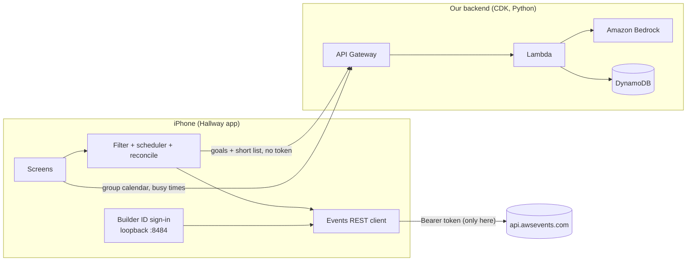

# Hallway

Plan your re:Invent 2026 week, alone or with your crew.

Hallway is a phone app for **iPhone and Android** (Expo / React Native) built on the new [AWS Events API](https://docs.aws.amazon.com/events/latest/devguide/what-is-events-api.html). You tell it what you want from re:Invent, an agent on Amazon Bedrock picks sessions, and Hallway builds a week that actually works: no clashes, a daily limit, and enough time to walk between venues. Then it favorites, reserves and blocks time in your real re:Invent account, and checks that every change landed.

With **groups**, you and your friends or team share a calendar: propose sessions, tap "I'm in" to reserve your own seat, find a time when everyone is free, or split sessions so the team covers more.

Built for the re:Invent 2026 Event Catalog API Hackathon.

## Features

| Feature | How it uses the API |
|---|---|
| Sign in with Builder ID | OAuth 2.0 + PKCE, with a tiny HTTP listener on the phone at `127.0.0.1:8484-8489/callback` |
| Full catalog on the phone | `ListEvents`, `ListSessions` (every page until `nextToken` is gone), cached locally |
| Search and filters | Done on the phone, the API has no search |
| Agent planner | Bedrock ranks a short list against your goals, the phone enforces clashes and walking time |
| Cert mode | Maps exam domains to `services` / `topics` (our own table) |
| Walking time | Venue to venue minutes (our own table), added as `CreatePersonalTime` blocks |
| Reserve and verify | `GetSession` for the live seat band, `ReserveSessions` scarcest first, per-session results, then `GetSchedule` |
| Replace full sessions | `sessionFull` failures trigger a re-plan around what you already have |
| My week | `GetSchedule`, `CancelReservation`, `DisassociateFavorite`, `UpdatePersonalTime`, `DeletePersonalTime` |
| Groups | Our backend stores the shared calendar. Each member's app talks to the AWS Events API for that member only |
| Sign out | Revokes the refresh token, optional full Builder ID logout |

All 12 operations of the API are used.

## How it works



**Your AWS login never leaves the phone.** The API only accepts sign-in redirects to `localhost` on the attendee's own device, and the token may only be sent to `api.awsevents.com`. So the app does every AWS Events call itself. The backend only gets what you choose to share: a display name, session ids and times for the group calendar, and busy time ranges (never what they are). Other members only ever see the combined free time.

**The agent picks, the code decides.** Bedrock returns session ids through a forced tool call. Ids that weren't in the candidate list are dropped. Then a plain scheduler on the phone removes clashes, applies the daily limit and checks the walk to the next venue.

**Write, then verify.** The API has no idempotency key and a `200` can hide per-session failures. Every change follows the same loop: read `GetSchedule`, send only what is missing, read each per-session result, and on a timeout or `5xx` re-read `GetSchedule` instead of repeating the request. Quotas (`429` + `Retry-After`), `409` (operation closed) and `403` (not registered) are handled.

## Repo layout

```
app/                 Expo app (TypeScript)
  src/api/           auth (PKCE + loopback), Events REST client, backend client
  src/logic/         time zones, filtering, scheduler, planner, reconcile loop
  src/data/          catalog cache, venue walking times, cert profiles
  src/screens/       Plan, Explore, My week, Groups
backend/             AWS CDK app (Python)
  lambda/            handler, groups (DynamoDB), planner (Bedrock), schedule math
  tests/             pytest (moto for DynamoDB)
```

## Requirements

- You must be registered for re:Invent 2026, or the catalog returns `403`
- Node.js 20+ and git
- To run on **iPhone or the iOS Simulator**: a Mac with Xcode (iOS apps can't be built on Windows or Linux)
- To run on **Android**: an Android phone or emulator. Building on your own computer (Windows, macOS or Linux) needs [Android Studio](https://developer.android.com/studio) (which brings the Android SDK) and JDK 17. Or skip all that and use the [cloud build](#android-phone-without-android-studio-cloud-build).
- For the backend: Python 3.12+, AWS CDK v2 (`npm i -g aws-cdk`), an AWS account with access to an Anthropic Claude model in Amazon Bedrock (us-east-1)

## Run it

### 1. Deploy the backend (optional, but needed for the agent and groups)

```bash
cd backend
python3 -m venv .venv && source .venv/bin/activate
pip install -r requirements.txt
cdk bootstrap        # first time per account/region
cdk deploy -c apiKey=<random string> -c alertEmail=you@example.com   # alertEmail is optional
```

Pick any random string for `apiKey` (or set `HALLWAY_API_KEY`); the app sends it as `x-api-key`. `/plan` is capped at 100 calls a day (`planDailyLimit` in `cdk.json`). See [DECISIONS.md](DECISIONS.md) for what these guards do and don't do.

Copy the `ApiUrl` output. The model is set in `cdk.json` (`bedrockModelId`), change it to any Claude model your account can use.

Without the backend, the app still works: planning falls back to ranking on the phone, and groups are disabled.

### 2. Set up the app (once)

```bash
cd app
npm install
echo "EXPO_PUBLIC_BACKEND_URL=https://xxxx.execute-api.us-east-1.amazonaws.com" > .env
echo "EXPO_PUBLIC_API_KEY=<the same apiKey>" >> .env
```

The `.env` file is not in git, so every new clone needs it. Skip the two `echo` lines to run without the backend.

### 3. Build the app once, then run it

> **Why not just `npx expo start`?** Sign-in uses a small native listener (`react-native-tcp-socket`) that **Expo Go does not include**. So the app has to be built once as a *development build* for your phone or simulator. After that, one command serves both platforms (see [Every day](#every-day-one-command-for-both-platforms)).

Pick the row that matches you:

| I want to run on... | Computer | Command |
|---|---|---|
| iOS Simulator | Mac | `npx expo run:ios` |
| My iPhone | Mac | `npx expo run:ios --device` |
| Android emulator | Windows, Mac or Linux | `npx expo run:android` |
| My Android phone, plugged in | Windows, Mac or Linux | `npx expo run:android --device` |
| My Android phone, no Android Studio | Any | [cloud build](#android-phone-without-android-studio-cloud-build) |

**iPhone (real device).** In Xcode, set your Apple ID as the signing team, and change `ios.bundleIdentifier` in `app.json` to something unique. On the phone, turn on Developer Mode and trust the developer profile in Settings > General > VPN & Device Management. Without a paid Apple developer account, the app expires after 7 days and only installs on your own devices.

**Android phone, plugged in.** On the phone: Settings > About phone > tap *Build number* 7 times, then Settings > Developer options > turn on *USB debugging*. Plug it in, accept the prompt on the phone, and check that `adb devices` lists it. Then run the command from the table.

**Android emulator.** In Android Studio, open Device Manager and create a Pixel phone, start it, then run the command from the table.

#### Android phone without Android Studio (cloud build)

This builds an installable `.apk` on Expo's servers (free Expo account), so it needs no Android SDK, and the app runs without your computer.

```bash
npx eas-cli login
npx eas-cli init                 # once: links this project to your Expo account
npx eas-cli env:set --environment preview --name EXPO_PUBLIC_BACKEND_URL --value https://xxxx.execute-api.us-east-1.amazonaws.com --visibility plaintext
npx eas-cli env:set --environment preview --name EXPO_PUBLIC_API_KEY --value <the same apiKey> --visibility plaintext
npx eas-cli build --platform android --profile preview
```

The two `env:set` lines are needed because the cloud build can't see your local `.env` (older `eas-cli` versions call this command `env:create`). When the build finishes it prints a link and a QR code. Open it on the phone, download the `.apk`, and allow "install unknown apps" for your browser when Android asks.

### Every day: one command for both platforms

Once the app is installed on your simulator or phone, start the dev server:

```bash
npx expo start --dev-client
```

Open the Hallway app on the phone or simulator and it connects (or press `i` for the iOS Simulator and `a` for an Android device or emulator in that terminal). iPhone and Android can connect to the same server at the same time. Edits then reload on the device without rebuilding. Rebuild only when a native dependency changes.

The phone must reach your computer: same Wi-Fi, and on iPhone allow *Local Network* for Hallway (Settings > Privacy & Security > Local Network). If the network blocks it, use `npx expo start --dev-client --tunnel`. A USB-plugged Android phone doesn't need Wi-Fi: `npx expo run:android --device` sets that up for you.

### Demo build (no computer needed)

A release build carries its own JavaScript, so it doesn't need the dev server or any network setup. Good for a demo.

```bash
npx expo run:ios --device --configuration Release          # Mac
npx expo run:android --device --variant release            # Android, plugged in
```

### 4. Tests

```bash
cd backend && pip install -r requirements-dev.txt && python -m pytest
cd app && npx tsc --noEmit
```

## Notes and limits

- Walking times and cert mappings are our own estimates (`app/src/data/venues.ts`, `app/src/data/certs.ts`). The API has venue names but no coordinates, and no certification field.
- The API gives seat bands (`available`, `limited`, `veryLimited`, `unavailable`, `walkUp`), not counts. Hallway reserves the scarcest sessions first.
- There is no waitlist in the API, and Hallway does not poll for freed seats.
- The API cannot tell who is calling it, by design: your Builder ID token never reaches the backend. See [DECISIONS.md](DECISIONS.md).
- Group data expires automatically after re:Invent (DynamoDB TTL, `expiresAt` in `cdk.json`).

## License

MIT
