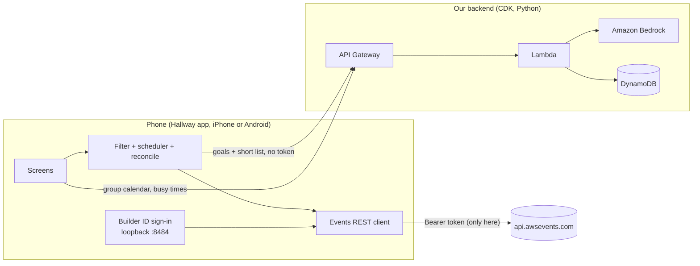

# Hallway

Plan your re:Invent 2026 week, alone or with your crew.

> ### Judges: start here
> **You do not need to deploy anything.** No AWS account, no CDK, no backend. The backend is already running and shared by everyone who tries the app. Read **[JUDGES.md](JUDGES.md)**: it has the install link, a five-minute tour, and how to try Groups together from different places.
>
> The [Run it yourself](#run-it-yourself) section further down is for developers who want their own copy. You can skip it.

Hallway is a phone app for **iPhone and Android** (Expo / React Native) built on the new [AWS Events API](https://docs.aws.amazon.com/events/latest/devguide/what-is-events-api.html). You tell it what you want from re:Invent, an agent on Amazon Bedrock picks sessions, and Hallway builds a week that actually works: no clashes, a daily limit, and enough time to walk between venues. Then it favorites, reserves and blocks time in your real re:Invent account, and checks that every change landed.

With **groups**, you and your friends or team share a calendar: propose sessions, tap "I'm in" to reserve your own seat, find a time when everyone is free, or split sessions so the team covers more.

Built for the re:Invent 2026 Event Catalog API Hackathon.

## Features

| Feature | How it uses the API |
|---|---|
| Sign in with Builder ID | OAuth 2.0 + PKCE, with a tiny HTTP listener on the phone at `127.0.0.1:8484-8489/callback` |
| Full catalog on the phone | `ListEvents`, `ListSessions` (every page until `nextToken` is gone), cached locally |
| Search and filters | Done on the phone, the API has no search |
| Agent planner | Bedrock ranks a short list against your goals, the phone enforces clashes and walking time |
| Cert mode | Maps exam domains to `services` / `topics` (our own table) |
| Walking time | Venue to venue minutes (our own table), added as `CreatePersonalTime` blocks |
| Reserve and verify | `GetSession` for the live seat band, `ReserveSessions` scarcest first, per-session results, then `GetSchedule` |
| Replace full sessions | `sessionFull` failures trigger a re-plan around what you already have |
| My week | `GetSchedule`, `CancelReservation`, `DisassociateFavorite`, `UpdatePersonalTime`, `DeletePersonalTime` |
| Groups | Our backend stores the shared calendar. Each member's app talks to the AWS Events API for that member only |
| Sign out | Revokes the refresh token, optional full Builder ID logout |

All 12 operations of the API are used.

## How it works



**Your AWS login never leaves the phone.** The API only accepts sign-in redirects to `localhost` on the attendee's own device, and the token may only be sent to `api.awsevents.com`. So the app does every AWS Events call itself. The backend only gets what you choose to share: a display name, session ids and times for the group calendar, and busy time ranges (never what they are). Other members only ever see the combined free time.

**The agent picks, the code decides.** Bedrock returns session ids through a forced tool call. Ids that weren't in the candidate list are dropped. Then a plain scheduler on the phone removes clashes, applies the daily limit and checks the walk to the next venue.

**Write, then verify.** The API has no idempotency key and a `200` can hide per-session failures. Every change follows the same loop: read `GetSchedule`, send only what is missing, read each per-session result, and on a timeout or `5xx` re-read `GetSchedule` instead of repeating the request. Quotas (`429` + `Retry-After`), `409` (operation closed) and `403` (not registered) are handled.

## Repo layout

```
app/                 Expo app (TypeScript)
  src/api/           auth (PKCE + loopback), Events REST client, backend client
  src/logic/         time zones, filtering, scheduler, planner, reconcile loop
  src/data/          catalog cache, venue walking times, cert profiles
  src/screens/       Plan, Explore, My week, Groups
backend/             AWS CDK app (Python)
  lambda/            handler, groups (DynamoDB), planner (Bedrock), schedule math
  tests/             pytest (moto for DynamoDB)
```

## Run it yourself

> **Not a judge? Read this first.** Hallway has two parts: the **app** on a phone, and a small **backend** (API Gateway, Lambda, DynamoDB, Bedrock) that powers the agent and Groups. The app needs a backend address to talk to, and you have two ways to get one:
>
> - **Use a backend that already exists.** If someone gives you a backend address and key (for example the Hallway team, for a demo), you only run the app. Skip step 1. **Judges do this.**
> - **Deploy your own backend.** Your own AWS account, about a minute with CDK. Needed only if you want your own copy, for example after forking. People on different backends cannot join each other's groups.
>
> Without any backend the app still works, but planning falls back to ranking on the phone and Groups is turned off.

### What you need

| For | You need |
|---|---|
| Any use | A Builder ID registered for re:Invent 2026 (otherwise the catalog returns `403`), Node.js 20+, git |
| The app on an **iPhone or the iOS Simulator** | A Mac with Xcode (iOS apps can't be built on Windows or Linux) |
| The app on **Android** | An Android phone or emulator. Building on your own computer (Windows, macOS or Linux) needs [Android Studio](https://developer.android.com/studio) and JDK 17, or use the [cloud build](#android-phone-without-android-studio-cloud-build), which needs neither |
| **Deploying your own backend** (step 1 only) | Python 3.12+, AWS CDK v2 (`npm i -g aws-cdk`), an AWS account with access to an Anthropic Claude model in Amazon Bedrock (us-east-1) |

### 1. Deploy your own backend (skip if you were given a backend address)

```bash
cd backend
python3 -m venv .venv && source .venv/bin/activate
pip install -r requirements.txt
cdk bootstrap        # first time per account/region
cdk deploy -c apiKey=<random string> -c alertEmail=you@example.com   # alertEmail is optional
```

Pick any random string for `apiKey` (or set `HALLWAY_API_KEY`); the app sends it as `x-api-key`. `/plan` is capped at 100 calls a day for everyone and 25 per caller, and each caller can create 20 groups a day (`planDailyLimit`, `planDailyLimitPerIp`, `groupDailyLimitPerIp`; pass them with `-c` or put them in `cdk.json`). See [DECISIONS.md](DECISIONS.md) for what these guards do and don't do.

Copy the `ApiUrl` output; that is your backend address. The model is set in `cdk.json` (`bedrockModelId`), change it to any Claude model your account can use.

### 2. Set up the app (once)

```bash
cd app
npm install
echo "EXPO_PUBLIC_BACKEND_URL=<backend address: the ApiUrl from step 1, or the one you were given>" > .env
echo "EXPO_PUBLIC_API_KEY=<the matching app key>" >> .env
```

The `.env` file is not in git, so every new clone needs it. Skip the two `echo` lines to run without a backend.

### 3. Build the app once, then run it

> **Why not just `npx expo start`?** Sign-in uses a small native listener (`react-native-tcp-socket`) that **Expo Go does not include**. So the app has to be built once as a *development build* for your phone or simulator. After that, one command serves both platforms (see [Every day](#every-day-one-command-for-both-platforms)).

Pick the row that matches you:

| I want to run on... | Computer | Command |
|---|---|---|
| iOS Simulator | Mac | `npx expo run:ios` |
| My iPhone | Mac | `npx expo run:ios --device` |
| Android emulator | Windows, Mac or Linux | `npx expo run:android` |
| My Android phone, plugged in | Windows, Mac or Linux | `npx expo run:android --device` |
| My Android phone, no Android Studio | Any | [cloud build](#android-phone-without-android-studio-cloud-build) |

**iPhone (real device).** See [Run it on an iPhone](#run-it-on-an-iphone-no-paid-apple-account) below.

**Android phone, plugged in.** On the phone: Settings > About phone > tap *Build number* 7 times, then Settings > Developer options > turn on *USB debugging*. Plug it in, accept the prompt on the phone, and check that `adb devices` lists it. Then run the command from the table.

**Android emulator.** In Android Studio, open Device Manager and create a Pixel phone, start it, then run the command from the table.

#### Android phone without Android Studio (cloud build)

This builds an installable `.apk` on Expo's servers (free Expo account), so it needs no Android SDK, and the app runs without your computer. This is also how you make an install link to hand to other people.

```bash
npx eas-cli login
npx eas-cli init                 # once: links this project to your Expo account
npx eas-cli env:set --environment preview --name EXPO_PUBLIC_BACKEND_URL --value <backend address> --visibility sensitive
npx eas-cli env:set --environment preview --name EXPO_PUBLIC_API_KEY --value <the matching app key> --visibility sensitive
npx eas-cli build --platform android --profile preview
```

The two `env:set` lines are needed because the cloud build can't see your local `.env` (older `eas-cli` versions call this command `env:create`). `sensitive` hides the values in Expo's build logs. It does **not** keep them secret: both values end up inside the app, and anything inside an app can be read by whoever installs it (Expo's own docs say so, and `secret` isn't allowed for app values). Treat the app key as a speed bump, not a password. When the build finishes it prints a link and a QR code. Open it on the phone, download the `.apk`, and allow "install unknown apps" for your browser when Android asks.

### Run it on an iPhone (no paid Apple account)

You do **not** need the $99 Apple Developer Program for this. A free Apple ID is enough. You do need a **Mac with Xcode** (free from the App Store), because iPhone apps can only be built on a Mac, and a USB cable.

1. Open Xcode once, go to *Xcode > Settings > Accounts*, and sign in with your Apple ID. You get a free "Personal Team".
2. On the iPhone: *Settings > Privacy & Security > Developer Mode* > turn on, and let it restart.
3. In `app/app.json`, change `ios.bundleIdentifier` to something unique to you, such as `com.yourname.hallway`. (Apple refuses an id that someone else already used.)
4. Do [step 2](#2-set-up-the-app-once) above (`npm install` and the `.env` file), plug the phone in, unlock it, and tap *Trust* if it asks.
5. Run:

   ```bash
   cd app
   npx expo run:ios --device
   ```

   Pick your iPhone from the list. The first build takes a few minutes. If Xcode complains about signing, open `app/ios/Hallway.xcworkspace`, select the Hallway target, and under *Signing & Capabilities* pick your Personal Team.
6. On the phone, the first launch says "Untrusted Developer". Go to *Settings > General > VPN & Device Management*, tap your Apple ID, and tap *Trust*. Then open Hallway.

**Limits of a free account:** the app stops opening after **7 days** (run the command again to renew it), it can only be installed on your own devices, and Apple limits how many apps like this can be on a phone at once.

By default this installs a development build that loads its code from your computer, so keep `npx expo start --dev-client` running on the same Wi-Fi and allow *Local Network* for Hallway when the phone asks. To get an app that works with no computer at all, add `--configuration Release`:

```bash
npx expo run:ios --device --configuration Release
```

### Every day: one command for both platforms

Once the app is installed on your simulator or phone, start the dev server:

```bash
npx expo start --dev-client
```

Open the Hallway app on the phone or simulator and it connects (or press `i` for the iOS Simulator and `a` for an Android device or emulator in that terminal). iPhone and Android can connect to the same server at the same time. Edits then reload on the device without rebuilding. Rebuild only when a native dependency changes.

The phone must reach your computer: same Wi-Fi, and on iPhone allow *Local Network* for Hallway (Settings > Privacy & Security > Local Network). If the network blocks it, use `npx expo start --dev-client --tunnel`. A USB-plugged Android phone doesn't need Wi-Fi: `npx expo run:android --device` sets that up for you.

### Demo build (no computer needed)

A release build carries its own JavaScript, so it doesn't need the dev server or any network setup. Good for a demo.

```bash
npx expo run:ios --device --configuration Release          # Mac
npx expo run:android --device --variant release            # Android, plugged in
```

### Tests

```bash
cd backend && pip install -r requirements-dev.txt && python -m pytest
cd app && npx tsc --noEmit
```

## Notes and limits

- Walking times and cert mappings are our own estimates (`app/src/data/venues.ts`, `app/src/data/certs.ts`). The API has venue names but no coordinates, and no certification field.
- The API gives seat bands (`available`, `limited`, `veryLimited`, `unavailable`, `walkUp`), not counts. Hallway reserves the scarcest sessions first.
- There is no waitlist in the API, and Hallway does not poll for freed seats.
- The API cannot tell who is calling it, by design: your Builder ID token never reaches the backend. See [DECISIONS.md](DECISIONS.md).
- Group data expires automatically after re:Invent (DynamoDB TTL, `expiresAt` in `cdk.json`).

## License

MIT
